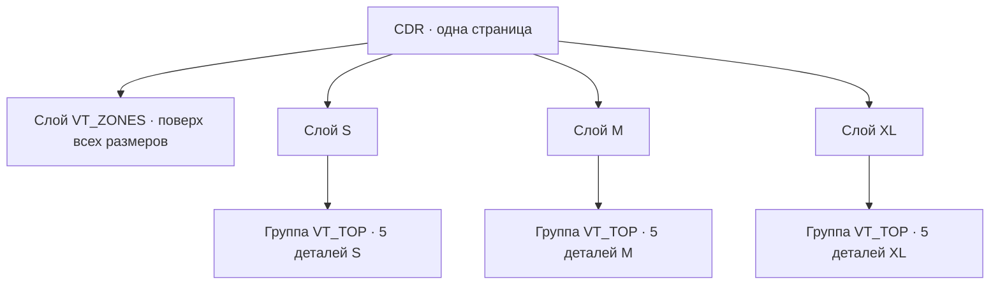

# Шаблон спортформы для Vanya Tools

Один файл CDR содержит **одну страницу**. Верхний слой называется `VT_ZONES` и содержит общие текстовые образцы и рамки нанесения. Остальные слои называются произвольно, но каждый слой должен обозначать один размер и иметь уникальное имя. Именно эти имена появятся в списке размеров таблицы игроков.

Размеры `S`, `M`, `XL` приведены для примера. Вы можете назвать слои иначе. Если одновременно видны лекала нескольких размеров, временно скрывайте лишние слои при подготовке файла; сохранённый CDR может содержать все слои.

На каждом слое размера должна быть одна группа `VT_TOP` с **ровно пятью** объектами:

| Объект | Деталь |
| --- | --- |
| `VT_FRONT` | полка |
| `VT_BACK` | спинка |
| `VT_SLEEVE_LEFT` | левый рукав |
| `VT_SLEEVE_RIGHT` | правый рукав |
| `VT_NECK` | горловина |

На общем слое `VT_ZONES` разместите следующие объекты. Имена объектов сохраняются прежними, поэтому прямоугольник можно заменить текстом с тем же именем.

| Имя объекта | Содержимое |
| --- | --- |
| `VT_SPORT_ZONE_FRONT_LEFT` | текстовый образец имени слева на груди |
| `VT_SPORT_ZONE_FRONT_RIGHT` | текстовый образец имени справа на груди |
| `VT_SPORT_ZONE_BACK` | отдельный текстовый образец имени на спине |
| `VT_SPORT_ZONE_BACK_NUMBER` | отдельный текстовый образец номера на спине |
| `VT_SPORT_ZONE_LEFT_SLEEVE` | прямоугольник для графики левого рукава |
| `VT_SPORT_ZONE_RIGHT_SLEEVE` | прямоугольник для графики правого рукава |
| `VT_SPORT_ZONE_NECK` | необязательный прямоугольник для графики горловины |

Образец — обычный **фигурный текст**, который остаётся текстом. Для имени напишите `XXXXXXXXX`, для двух строк имени — две строки `XXXXXXXXX` в одном текстовом объекте. Для номера используйте `XX` или `XXX`. Выберите шрифт, кегль, начертание, цвет, обводку, выравнивание и межстрочный интервал средствами Corel. Текст не нужно переводить в кривые или группировать с рамкой.

Генерация копирует оформление каждой строки образца. Короткие имена и номера сохраняют его кегль; слишком широкие пропорционально уменьшаются до ширины образца. Итоговая надпись располагается по центру его области. В двухстрочном имени перенос идёт после первого слова; символ `|` в таблице позволяет выбрать перенос вручную. Пустые данные и образец на невыбранной стороне груди не оставляют символов X в печати.

Положение образцов и рамок должно подходить к контурам каждого размера, поскольку исходный слой общий. После этапа 1 их можно двигать и оформлять отдельно на слое каждого размера. Чтобы заменить бокс уже на обзорной странице, создайте и выделите текст, затем нажмите «Имя груди слева», «Имя груди справа», «Имя на спине» или «Номер на спине». Кнопка назначит имя объекта и заменит прежнюю область на этом слое.

Прямоугольники для имени и номера продолжают работать с настройками из раздела «Настройки прямоугольных боксов». Текстовые образцы берут оформление из Corel и количество строк из образца.

Во вкладке «Спортформа» нажмите «Выбрать модель CDR». Первый этап создаст в текущем документе одну обзорную страницу со всеми размерами рядом. На ней можно отдельно поправить рисунки, контуры и боксы. Второй этап берёт эти правки и создаёт страницу печати указанной ширины. Для плотной укладки разрешите поворот рукавов и горловины на 90° только если направление рисунка и ткани это допускает.

Исходный CDR модели остаётся открытым в отдельной вкладке, а рабочий документ остаётся активным. Повторные операции используют уже открытую модель. Это исключает автозакрытие исходного документа, пока Corel и плагин ещё держат ссылки на его объекты.

На обзорной странице для каждой детали создаётся группа `VT_SPORT_ART_FRONT`, `VT_SPORT_ART_BACK`, `VT_SPORT_ART_LEFT_SLEEVE`, `VT_SPORT_ART_RIGHT_SLEEVE` или `VT_SPORT_ART_NECK`, даже если её рисунок не выбран. В эту группу можно добавить графику до второго этапа. Стороны груди теперь соответствуют именам боксов без зеркального обмена: `FRONT_LEFT` — левый бокс на странице, `FRONT_RIGHT` — правый.

Крестик возле поля рисунка очищает выбранную деталь для всех размеров на текущей обзорной странице. Пустое поле правого рукава оставляет его без печатного рисунка; рисунок левого рукава больше не подставляется автоматически.
