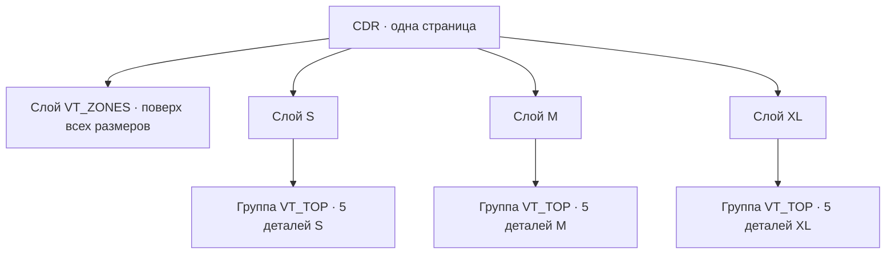

# Шаблон спортформы для Vanya Tools

Один файл CDR содержит **одну страницу**. Верхний слой называется `VT_ZONES` и содержит общие боксы нанесения. Остальные слои называются произвольно, но каждый слой должен обозначать один размер и иметь уникальное имя. Именно эти имена появятся в списке размеров таблицы игроков.

Размеры `S`, `M`, `XL` приведены для примера. Вы можете назвать слои иначе. Если одновременно видны лекала нескольких размеров, временно скрывайте лишние слои при подготовке файла; сохранённый CDR может содержать все слои.

На каждом слое размера должна быть одна группа `VT_TOP` с **ровно пятью** объектами:

| Объект | Деталь |
| --- | --- |
| `VT_FRONT` | полка |
| `VT_BACK` | спинка |
| `VT_SLEEVE_LEFT` | левый рукав |
| `VT_SLEEVE_RIGHT` | правый рукав |
| `VT_NECK` | горловина |

На общем слое `VT_ZONES` разместите прямоугольники с именами `VT_SPORT_ZONE_FRONT_LEFT`, `VT_SPORT_ZONE_FRONT_RIGHT`, `VT_SPORT_ZONE_BACK`, `VT_SPORT_ZONE_BACK_NUMBER`, `VT_SPORT_ZONE_LEFT_SLEEVE`, `VT_SPORT_ZONE_RIGHT_SLEEVE`. Бокс `VT_SPORT_ZONE_NECK` необязателен. Положение боксов должно подходить к контурам каждого размера, поскольку этот слой общий; после этапа 1 боксы можно двигать отдельно на слое каждого размера.

Во вкладке «Спортформа» нажмите «Выбрать модель CDR». Первый этап создаст в текущем документе одну обзорную страницу со всеми размерами рядом. На ней можно отдельно поправить рисунки, контуры и боксы. Второй этап берёт эти правки и создаёт страницу печати указанной ширины. Для плотной укладки разрешите поворот рукавов и горловины на 90° только если направление рисунка и ткани это допускает.

На обзорной странице для каждой детали создаётся группа `VT_SPORT_ART_FRONT`, `VT_SPORT_ART_BACK`, `VT_SPORT_ART_LEFT_SLEEVE`, `VT_SPORT_ART_RIGHT_SLEEVE` или `VT_SPORT_ART_NECK`, даже если её рисунок не выбран. В эту группу можно добавить графику до второго этапа. Стороны груди теперь соответствуют именам боксов без зеркального обмена: `FRONT_LEFT` — левый бокс на странице, `FRONT_RIGHT` — правый.

Крестик возле поля рисунка очищает выбранную деталь для всех размеров на текущей обзорной странице. Пустое поле правого рукава оставляет его без печатного рисунка; рисунок левого рукава больше не подставляется автоматически.
