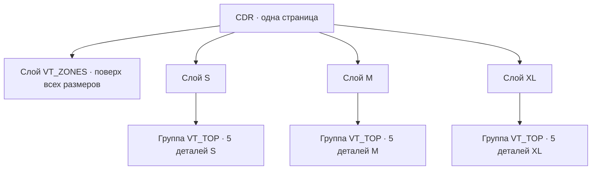

# Шаблон спортформы для Vanya Tools

Один файл CDR содержит **одну страницу**. Верхний слой называется `VT_ZONES` и содержит общие текстовые образцы и рамки нанесения. Остальные слои называются произвольно, но каждый слой должен обозначать один размер и иметь уникальное имя. Именно эти имена появятся в списке размеров таблицы игроков.



Размеры `S`, `M`, `XL` приведены для примера. Вы можете назвать слои иначе. Если одновременно видны лекала нескольких размеров, временно скрывайте лишние слои при подготовке файла; сохранённый CDR может содержать все слои.

На каждом слое размера должна быть одна группа `VT_TOP` с **ровно пятью группами деталей**:

| Объект | Деталь |
| --- | --- |
| `VT_FRONT` | полка |
| `VT_BACK` | спинка |
| `VT_SLEEVE_LEFT` | левый рукав |
| `VT_SLEEVE_RIGHT` | правый рукав |
| `VT_NECK` | горловина |

Внутри каждой группы детали находится один **замкнутый векторный контур `silhouette`**. Он задаёт внешний силуэт детали. Там же могут находиться другие кривые — надсечки и линии для резки; их имена произвольные. Для резки поддерживаются кривые и обычные векторные фигуры Corel. Общие зоны и текстовые образцы размещайте на `VT_ZONES`.

`silhouette` также может быть векторной фигурой Corel: например, прямоугольником горловины. Для печати в кривую переводится только её временная копия, после чего строится наружный контур +6 мм. В резке исходная фигура сохраняется как есть вместе со всеми остальными кривыми группы. Сам поиск `silhouette` не проверяет остальные объекты группы; состав линий резки проверяется при создании раскладки резки.

```text
Слой размера (например, 128)
└── VT_TOP
    ├── VT_FRONT
    │   ├── silhouette
    │   └── остальные кривые резки
    ├── VT_BACK
    │   ├── silhouette
    │   └── остальные кривые резки
    ├── VT_SLEEVE_LEFT
    │   ├── silhouette
    │   ├── надсечка 1
    │   └── надсечка 2
    ├── VT_SLEEVE_RIGHT
    │   ├── silhouette
    │   └── надсечки
    └── VT_NECK
        └── silhouette
```

**Печать:** первый этап создаёт отдельную кривую со сдвигом наружу на **6 мм** от `silhouette`. Это настоящий наружный контур, а не увеличение габаритов. Он становится контейнером для рисунка и определяет габариты печатной раскладки. Сдвиг применяется после масштабирования размера, поэтому остаётся 6 мм при любом масштабе. Исходная группа резки сохраняется целиком рядом с контейнером и именуется `VT_SPORT_CUT_FRONT`, `VT_SPORT_CUT_BACK`, `VT_SPORT_CUT_LEFT_SLEEVE`, `VT_SPORT_CUT_RIGHT_SLEEVE` или `VT_SPORT_CUT_NECK`. Подпись в подгибке располагается относительно исходного силуэта, а не края увеличенного контейнера.

**Резка:** копируются **все кривые исходной группы**, в том числе сама `silhouette` и мелкие надсечки, без сдвига контура и изменения взаимного положения. Рисунки, печатный контейнер +6 мм, рамки нанесения и печатные надписи в резку не попадают. При отключённых ушках кривые остаются исходными. При включённых ушках на копии `silhouette` изменяются только два коротких участка прямого края для перемычек, добавляются контур ушка и прорезной размер. Имена игрока, размера и детали также сохраняются в именах групп.

Прежние шаблоны, в которых деталь была одной кривой вместо группы, поддерживаются: эта кривая используется как исходный силуэт и как линия резки.

На общем слое `VT_ZONES` разместите следующие объекты. Имена объектов сохраняются прежними, поэтому прямоугольник можно заменить текстом с тем же именем.

| Имя объекта | Содержимое |
| --- | --- |
| `VT_SPORT_ZONE_FRONT_LEFT` | текстовый образец имени слева на груди |
| `VT_SPORT_ZONE_FRONT_RIGHT` | текстовый образец имени справа на груди |
| `VT_SPORT_ZONE_BACK` | отдельный текстовый образец имени на спине |
| `VT_SPORT_ZONE_BACK_NUMBER` | отдельный текстовый образец номера на спине |
| `VT_SPORT_ZONE_LEFT_SLEEVE` | текстовый образец номера или прямоугольник для графики левого рукава |
| `VT_SPORT_ZONE_RIGHT_SLEEVE` | текстовый образец номера или прямоугольник для графики правого рукава |
| `VT_SPORT_ZONE_NECK` | необязательный текстовый образец номера или прямоугольник для графики горловины |

Образец — обычный **фигурный текст**, который остаётся текстом. Для имени напишите `XXXXXXXXX`, для двух строк имени — две строки `XXXXXXXXX` в одном текстовом объекте. Для номера используйте `XX` или `XXX`. Выберите шрифт, кегль, начертание, цвет, обводку, выравнивание и межстрочный интервал средствами Corel. Текст не нужно переводить в кривые или группировать с рамкой.

Генерация копирует оформление каждой строки образца. Короткие имена и номера сохраняют его кегль; слишком широкие пропорционально уменьшаются до ширины образца. Итоговая надпись располагается по центру его области. В двухстрочном имени перенос идёт после первого слова; символ `|` в таблице позволяет выбрать перенос вручную. Пустые данные и образец на невыбранной стороне груди не оставляют символов X в печати.

Положение образцов и рамок должно подходить к контурам каждого размера, поскольку исходный слой общий. После этапа 1 их можно двигать и оформлять отдельно на слое каждого размера. Чтобы заменить бокс уже на обзорной странице, создайте и выделите текст, затем нажмите «Имя груди слева», «Имя груди справа», «Имя на спине» или «Номер на спине». Кнопка назначит имя объекта и заменит прежнюю область на этом слое.

Все текстовые области необязательны. Удалите ненужный объект с `VT_ZONES`, чтобы не печатать его ни для одного размера, или с отдельного слоя обзорной страницы, чтобы пропустить его только для этого размера. Например, можно удалить `VT_SPORT_ZONE_RIGHT_SLEEVE` у маленьких размеров. Этап 2 не создаёт удалённые поля заново; имя на спине и номер на спине работают независимо.

Этап 1 также создаёт фигурные текстовые образцы подписей в подгибке каждой детали: `VT_SPORT_CAPTION_FRONT`, `VT_SPORT_CAPTION_BACK`, `VT_SPORT_CAPTION_LEFT_SLEEVE`, `VT_SPORT_CAPTION_RIGHT_SLEEVE`, `VT_SPORT_CAPTION_NECK`. В образце видны `XXXXXXXXX · №XX · размер · деталь`. Меняйте шрифт, кегль, цвет, обводку и положение на слое размера. Этап 2 подставляет данные игрока, сохраняет оформление и левый нижний край образца; слишком длинная подпись уменьшается до его ширины. Удалённая подпись также пропускается. Эти изменения требуют нового запуска этапа 1; у старых обзорных страниц сохраняются автоматические подписи прежнего вида.

Шрифт, кегль, наклон, начертание, цвет, обводку и интервалы меняйте в текстовом образце средствами Corel. Выбор шрифта и начертания из вкладки спортформы удалён. Текстовые образцы берут оформление и количество строк из CDR. Прежние макеты с прямоугольниками поддерживаются с оформлением старого черновика; для новых макетов используйте текстовые образцы.

Во вкладке «Спортформа» нажмите «Выбрать модель CDR». Первый этап создаст в текущем документе одну обзорную страницу: **два столбца целых комплектов размеров**, следующая пара располагается ниже. Порядок слева направо и сверху вниз соответствует таблице размеров. Каждая ячейка содержит все детали одного размера, рисунки, зоны нанесения, подписи и название размера; масштаб деталей сохраняется. Размер остаётся на отдельном слое. Ширина столбцов и высота каждого ряда определяются по полным габаритам комплектов, расстояние между ячейками — 40 мм, поля страницы — 20 мм. Страница сначала получает итоговый размер, затем комплекты размещаются от её фактического верхнего левого угла. На ней можно отдельно поправить рисунки, контуры и текстовые образцы. Второй этап берёт эти правки и создаёт страницу печати указанной ширины. Для плотной укладки разрешите поворот рукавов и горловины на 90° только если направление рисунка и ткани это допускает.

## Вставка таблицы игроков

Скопируйте диапазон любого количества строк из Excel или Google Таблиц и нажмите `Ctrl+V` в выбранной ячейке редактора. Значения заменят соответствующие ячейки, недостающие строки добавятся автоматически. Можно вставить только столбец имён или номеров, начиная с нужной ячейки: остальные данные существующих строк сохранятся. Кнопка «Добавить из Excel / Google Таблиц» добавляет весь диапазон в конец таблицы. «Убрать строки» удаляет все строки выбранного диапазона.

Если копируете только столбец имён, вставьте его в пустую таблицу или нажмите «Добавить из Excel / Google Таблиц». Все имена попадут в столбец «Имя», новые строки останутся без размера и с количеством 1. Размеры назначьте после вставки: выделите группу ячеек с Shift или несколько строк с Ctrl, выберите «Размер выделенным» и нажмите «Назначить». Можно по-прежнему выбирать размер в каждой строке. Генерация попросит заполнить оставшиеся пустые размеры. Одиночный столбец размеров или номеров вставляйте в соответствующие ячейки либо копируйте вместе с заголовком «Размер» или «№».

Без заголовков порядок столбцов: **размер, имя, номер, количество**. С заголовками порядок произвольный: распознаются «Размер»/«Рост», «Имя»/«ФИО», «Номер»/«№», «Количество»/«Шт.». Отдельные столбцы «Фамилия» и «Имя» объединяются. Размер должен совпадать с именем слоя; числовой рост, например `152`, также подходит, если в модели есть ровно один слой с этим числом в конце имени. Пустое количество означает один комплект; номера вроде `007` сохраняются текстом. Пустые строки пропускаются, переносы внутри скопированных текстовых ячеек поддерживаются. Если найдены некорректные размеры или количества, весь диапазон остаётся без изменений и выводится номер строки с ошибкой.

## Раскладка резки

В разделе «Раскладка резки» нажмите «Создать раскладку резки». Размеры и количество комплектов берутся из таблицы игроков, ширина полотна и расстояние — из общих настроек. Детали размещаются с учётом контуров на отдельной странице текущего CDR, без отступа от края. Галочка «Разрешить поворот деталей резки на 180°» разрешает автоматический выбор между 0° и 180° для каждой детали. Поворота на 90° для резки нет; при отключённой галочке сохраняется исходное направление.

При уплотнении учитываются `silhouette` и остальные линии детали, включая надсечки. Профиль строится с шагом до 2 мм; для кривых Безье используются покрывающие границу области, чтобы не уменьшать реальный зазор. По всей высоте каждой страницы сохраняются занятые интервалы: рукава и горловины могут заполнять промежутки между ранее размещёнными деталями. Скосы и дуги рукавов учитываются при проверке столкновений. Исходные узлы и кривые не меняются. Для резки рассматриваются только исходное направление и разрешённый галочкой поворот на 180°.

## Длина страниц и заполнение свободных мест

Настройка **«Макс. длина страницы, м»** применяется к печати и резке, по умолчанию **4 м**. Допускается от 0,5 до 45 м. Настройка сохраняется на этом ПК. Раскладка создаётся на нескольких страницах текущего CDR; ни одна не превышает заданную длину. **«Ширина печати, мм»** задаёт ширину бумаги для печати, **«Ширина ткани для резки, мм»** в разделе резки — ширину ткани независимо от бумаги. Оба поля принимают 300–4000 мм и запоминаются отдельно. При первом открытии старого черновика прежняя ширина переносится в оба поля. Зазор и ограничение длины остаются общими. Один комплект может быть распределён между страницами; имена групп и подписи деталей позволяют найти его части. Обзорная страница этапа 1 остаётся отдельной сеткой размеров.

Для печати проверяются габариты полных групп, а разрешённый поворот рукавов и горловины на 90° применяется вместе с рисунком и подписями. Для резки проверяются профили исходной геометрии с поворотом только на 180° или без него. Поиск возвращается к свободным местам на предыдущих страницах, прежде чем создать новую. Сравниваются три порядка укладки: выбирается вариант с меньшим числом страниц, затем с меньшей общей длиной и более ровным заполнением по ширине. Детали последнего ряда по возможности выравниваются к общему нижнему краю без увеличения страницы и пересечений. Алгоритм эвристический и не гарантирует абсолютный минимум материала.

Страницы получают номера `1/N`, `2/N` и так далее. После генерации открывается первая страница. Общая длина и число страниц показаны в докере. **«Сохранить страницу резки в отдельный CDR» сохраняет только активную страницу**: при многостраничной раскладке переключайтесь между страницами и выбирайте отдельные имена файлов.

## Экспорт листов печати

После этапа 2 откройте нужный лист печати и в разделе **«Экспорт печати»** выберите папку. Кнопка **«Экспортировать активный лист печати в PDF»** создаёт отдельный PDF только этой страницы: сохраняются её полная ширина, длина и масштаб **1:1**, независимо от выделенных объектов. Обзорная страница размеров и страницы резки не экспортируются этой кнопкой. Папка и качество сохраняются в черновике на этом ПК. Имена файлов содержат имя CDR, номер страницы и время; прежние PDF не перезаписываются.

По умолчанию используется компактный режим: цветные и серые изображения уменьшаются до **150 DPI**, JPEG-сжатие с качеством **95%**. Детальный режим повышает предел до **300 DPI**. Исходники с меньшим разрешением не увеличиваются искусственно. Надписи выводятся кривыми и вместе с остальной векторной графикой сохраняют чёткость независимо от DPI. Весь многометровый лист не превращается в единый растр. PDF 1.7 сохраняет прозрачность, текстовые и векторные потоки сжимаются. Вылеты PDF, метки обрезки и служебная информация отключены: припуск +6 мм уже включён в печатные детали. Исходные цветовые модели сохраняются режимом `pdfNative`; устаревший переключатель `UseColorProfile`, который Corel 2026 отклоняет с `E_NOTIMPL`, не используется. Профиль материала и зеркалирование задавайте в программе печати. При ошибке настройки экспорта сообщение и журнал показывают имя параметра PDF; восстанавливаются только параметры, которые удалось изменить.

Экспорт в масштабе 1:1 ограничен страницей до **5,08 м** по каждой стороне, чтобы исключить автоматическое уменьшение крупного макета при выводе Corel в PDF. Стандартные листы длиной 4 м подходят. Для нескольких листов откройте каждый по очереди и повторите экспорт; в результате показаны физические размеры, размер файла и путь. PDF сначала создаётся в системной временной папке, затем копируется в папку печати с расширением `.partial` и получает окончательное имя `.pdf` только после завершения копирования. Настройки PDF и единицы рабочего CDR восстанавливаются после операции; геометрия и исходный CDR не меняются.

## Съёмный язычок с прорезным размером для лазерной резки

Галочка **«Съёмный язычок с прорезным размером на каждой детали»** добавляет П-образный выступ непосредственно к нижнему краю детали. Между язычком и деталью остаются два непрорезанных промежутка на исходной линии; дополнительных ножек нет. Настройки в миллиметрах: ширина по умолчанию **24**, высота **12** (минимум 12), длина каждого мостика **2**, высота буквы **8**. Высота буквы должна быть хотя бы на 2 мм меньше высоты язычка. Длинная метка автоматически увеличивает ширину; высота надписи сохраняется.

Надпись — собственные однолинейные чертёжные векторные знаки с разрывами замкнутых частей. Это не системный шрифт и не заявление о соответствии ГОСТ. Гравировка и двойные контуры букв не используются. Поддерживаются латинские буквы, цифры, `+`, `-`, `/`, `.`; М/С/Х/Л приводятся к M/S/X/L. Из `фо140` или `128 рост` получается `140` или `128`.

**Положение по размеру:** левый угол крепления первого язычка находится в 10 мм по горизонтали от левого габарита `silhouette` в ориентации подготовленного шаблона. Следующие размеры получают отступы 30, 50, 70 мм и далее. Первый отступ и шаг настраиваются. Порядок определяется площадью исходной `silhouette` переда с учётом масштаба, от меньшей к большей; используются все размеры списка шаблонов, а не только текущие игроки. При одинаковой площади применяется порядок названий. После изменения списка шаблонов или их геометрии порядок может измениться. Все размеры должны быть подготовлены на этапе 1.

Место крепления должно лежать на свободном прямом нижнем крае в рассчитанной позиции. Поддерживаются наклонные края, прямые Безье и сонаправленные сегменты на одной линии с допуском 0,05 мм. Направление наружу проверяется по исходному контуру. Проверяются остальные участки силуэта и все надсечки. Автоматического смещения в другую позицию нет: если язычок не помещается, сообщение показывает размер, деталь и отступ; измените отступ/шаг или отключите язычки. Это сохраняет идентификацию размера по положению. На коротких деталях большие отступы могут не помещаться.

На копии `silhouette` точно вырезаются только два интервала мостиков, включая деление Безье и стыки сегментов. Добавляются П-образный контур и линии символов. Исходный CDR и обзорная страница не меняются. Весь габарит язычка учитывается в раскладке; поворот резки только 0°/180°. Повторяющиеся детали копируются из уже подготовленного образца размера.

### Лист пробной резки язычков

Кнопка **«Лист язычков для пробной резки»** создаёт новую страницу текущего CDR без таблицы игроков и лекал. Варианты ширины: текущая, −4 и +4 мм в допустимых пределах. Для каждой ширины создаются мостики 1 / 1,5 / 2 / 2,5 / 3 мм и заданная длина, если она отличается. Высота язычка и буквы — из настроек. Добавляются примеры S, XS, XL, XXL, 116, 128, 152. При значениях по умолчанию получается **22 образца**.

Каждый образец — прямоугольный купон с язычком. На купоне прорезными однолинейными знаками указан код, например **24X12/B2**: ширина 24 мм, высота 12 мм, каждый из двух мостиков 2 мм. Все линии, включая код, предназначены для сквозной резки. Страницу можно сохранить кнопкой отдельного CDR. Удержание перемычек проверяется на образце вашей ткани с вашим режимом лазера.

Кнопка «Сохранить страницу резки в отдельный CDR…» сохраняет только открытую страницу резки как копию. Рабочий документ сохраняет прежний путь. Версия CDR берётся из настройки версии сохранения. Выберите отдельное имя файла; нельзя перезаписать CDR, который сейчас открыт. Прежние обзорные страницы без групп `VT_SPORT_CUT_*` нужно подготовить заново на этапе 1.

Исходный CDR модели остаётся открытым в отдельной вкладке, а рабочий документ остаётся активным. Повторные операции используют уже открытую модель. Это исключает автозакрытие исходного документа, пока Corel и плагин ещё держат ссылки на его объекты.

Перед созданием обзорной страницы проверяются группы и имена деталей всех выбранных размеров. При ошибке в одном слое выводится его имя и список недостающих деталей; импорт рисунков ещё не начинается. Перенос между CDR ожидает освобождения буфера обмена и повторяет временно неудавшееся копирование до трёх попыток. Если буфер остаётся занят, сообщение показывает размер и, когда Windows позволяет определить его, приложение, удерживающее буфер.

Во время ожидания обрабатываются входящие синхронные сообщения Windows: это позволяет Corel передать отложенные данные буфера по запросу системной службы. Мышь, клавиатура, таймеры и отложенные команды докера остаются в очереди до завершения операции. Службы Windows и настройки истории буфера не меняются.

На обзорной странице для каждой детали создаётся группа `VT_SPORT_ART_FRONT`, `VT_SPORT_ART_BACK`, `VT_SPORT_ART_LEFT_SLEEVE`, `VT_SPORT_ART_RIGHT_SLEEVE` или `VT_SPORT_ART_NECK`, даже если её рисунок не выбран. В эту группу можно добавить графику до второго этапа. Стороны груди теперь соответствуют именам боксов без зеркального обмена: `FRONT_LEFT` — левый бокс на странице, `FRONT_RIGHT` — правый.

Крестик возле поля рисунка очищает выбранную деталь для всех размеров на текущей обзорной странице. Пустое поле правого рукава оставляет его без печатного рисунка; рисунок левого рукава больше не подставляется автоматически.
